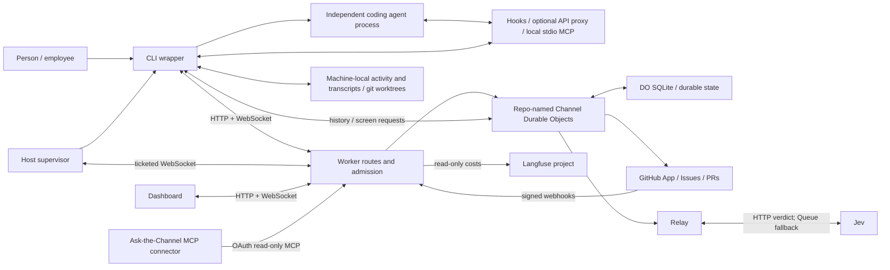

# Switchboard current-state audit

Repository: https://github.com/shlok1806/switchboard  
Branch: `bulletin`  
Audited application HEAD: `fe392689db002edb058eca9b6047be577c5bb656`  
Date: 2026-11-12  
Method: Codex investigation, agy review pending.

[FACT-CODE] Read-only git inspection found checkout HEAD `de0b25ff15178330df09bd67ca170deb66360928`. Its difference from the audited SHA adds only four reports under `audit/`; application code/tests and cited line numbers are unchanged. Baseline identity is the audited SHA (`baseline_logs/env.txt:3-4`, report-directory evidence).

Legend: [FACT-CODE] inspected implementation; [FACT-TEST] inspected named test assertions; [DOC-ONLY] documentation only; [INFERENCE] conclusion from cited evidence; [RECOMMENDATION] proposal. Repo paths are relative to repo root; baseline paths are relative to this report directory. An “extension point” cites existing code, not an implementation of the missing capability.

Statuses use exactly: Implemented and verified / Implemented but unverified / Partially implemented / Not implemented / Blocked by a current architectural constraint. Here Implemented and verified means code plus a proving test in source; the matrix additionally requires baseline pass evidence. The compact logs provide aggregate results, not individual case lines: mapping each non-gated named test into its passing package suite is [INFERENCE]. Verification is limited to the described assertion, not production operation or model obedience.

Baseline: 14/14 steps exited zero, 95 files passed and two skipped, 1,347 tests passed, zero failed, two skipped, 203 screenshots generated (`SWITCHBOARD_BASELINE_RESULTS.md`, Recorded results; `baseline_logs/summary.tsv:2-16`; `baseline_logs/06_worker_test.log:44-45`; `baseline_logs/09_cli_test.log:21-22`; `baseline_logs/13_dashboard_test.log:9-10`; `baseline_logs/14_dashboard_shots.log:5`). No tests/builds/installs were run in this investigation. “not run” below means no capability-specific execution established, even though its package suite may have passed.

## Architecture

[FACT-CODE] Diagram edge evidence: wrapper PTY `runCli`, `cli/src/run.ts:1166-1175`; local hooks/MCP installation `claude.install`, `cli/src/clis/claude.ts:65-79`, `codex.install`, `cli/src/clis/codex.ts:356-368`; Host tickets `Hosts.spawn`, `worker/src/hosts.ts:399-508`; HTTP/WS client `ChannelClient`, `cli/src/channel-client.ts:224-259`, `:276-324`; Worker admission and DO selection `handleChannel/channelOf`, `worker/src/index.ts:63-65`, `:272-324`; durable schema/storage `Tasks`, `worker/src/tasks.ts:131-156`, `Channel.insert`, `worker/src/channel.ts:2290-2336`; machine-history exchange `Channel.withLocalEvents`, `worker/src/channel.ts:1670-1690`; App GitHub access `gitHubFor`, `worker/src/github/index.ts:70-74`, signed webhook handler `worker/src/tasks-api.ts:84-109`; Jev `HttpJev.verdict`, `worker/src/relay/jev.ts:66-85`; Dashboard `App`, `dashboard/src/App.tsx:14-28`; connector/Langfuse `handleMcp`, `worker/src/mcp/server.ts:74-108`. Diagram is a logical topology, not a deployment or throughput measurement.

## Subsystems

Each status describes the subsystem scope and stated limitations. Evidence bullets inherit the implementation tag and baseline caveats above. More granular statuses appear in the capability matrix; a partial subsystem can contain verified primitives.

### 1. Identity, membership, registration and authentication

**Status: Implemented and verified.**

[FACT-CODE] `Access.admit` resolves a Person session or stored Agent-token hash and then checks repo membership. `AgentRoster.register` derives the Agent ID from Person, CLI and session and rejects full-session collisions (`worker/src/access.ts:92-148`; `worker/src/agents.ts:252-261`). Registration switches the official client from Person to Agent credential (`ChannelClient.register`, `cli/src/channel-client.ts:230-235`). [INFERENCE] This is accountable session identity, not a persistent company/vendor principal. The sampled test evidence below establishes local authorization behavior, not real GitHub availability.

- **Agent token attribution — Implemented and verified.** [FACT-CODE] worker/src/access.ts:92-114 Access.admit. [FACT-TEST] `worker/test/identity.test.ts:339-357`, it("are issued when the Person's session registers an Agent, and act as that Agent"). Baseline: pass — worker aggregate; case mapping [INFERENCE]. [INFERENCE] Limit: Fixture identity, not vendor attestation.

- **Membership refresh — Implemented and verified.** [FACT-CODE] worker/src/access.ts:117-148 Access.checkMember. [FACT-TEST] `worker/test/identity.test.ts:285-309`, it("re-checks write access at most every 5 minutes, and refuses someone who lost it"). Baseline: pass — worker aggregate; case mapping [INFERENCE]. [INFERENCE] Limit: Cached access persists until refresh.

- **Gone revokes token — Implemented and verified.** [FACT-CODE] worker/src/access.ts:192-194 Access.revokeAgent. [FACT-TEST] `worker/test/identity.test.ts:388-418`, it("stop working when the Agent goes Gone, and resuming issues a new one"). Baseline: pass — worker aggregate; case mapping [INFERENCE]. [INFERENCE] Limit: Resume needs Person registration.

- **Recent-member outage grace — Implemented and verified.** [FACT-CODE] worker/src/access.ts:124-139 Access.checkMember. [FACT-TEST] `worker/test/identity.test.ts:311-319`, it("keeps a recent member in while GitHub cannot be reached, and nobody else"). Baseline: pass — worker aggregate; case mapping [INFERENCE]. [INFERENCE] Limit: Recent member/newcomer distinction, not every outage duration.

### 2. Channels, Tasks, Claims, dependencies and Subtasks

**Status: Implemented and verified.**

[FACT-CODE] `channelOf` selects one DO by repository name; `Tasks` stores integer Issue numbers and JSON (`worker/src/index.ts:63-65`; `worker/src/tasks.ts:131-156`). `readMirror/mirroredFields` import body, labels, Markdown Steps, parent/subissues and open blockers; `Tasks.apply` preserves workflow fields and ignores unknown already-closed Issues (`worker/src/tasks.ts:86-110`, `:321-344`). [INFERENCE] This is useful GitHub coordination, not a provider-neutral work graph. Status applies to the mirrored and reconciled fields tested below.

- **Issue fields, Steps, blockers and Subtasks — Implemented and verified.** [FACT-CODE] worker/src/tasks.ts:86-110 readMirror/mirroredFields. [FACT-TEST] `worker/test/tasks.test.ts:101-155`, it("shows each open Issue as a Task, with Subtasks under their parent, Steps and blockers"). Baseline: pass — worker aggregate; case mapping [INFERENCE]. [INFERENCE] Limit: Unknown already-closed Issues omitted.

- **Repo Channel partition key — Implemented but unverified.** [FACT-CODE] worker/src/index.ts:63-65 channelOf. Test evidence: none (not test-covered). Baseline: not run — specific capability. [INFERENCE] Limit: One partition per repo.

- **Missed-webhook reconciliation — Implemented and verified.** [FACT-CODE] worker/src/tasks.ts:200-222 Tasks.alarm/ensureSynced. [FACT-TEST] `worker/test/tasks.test.ts:268-290`, it("repairs missed webhooks: edits, new Issues and closes"). Baseline: pass — worker aggregate; case mapping [INFERENCE]. [INFERENCE] Limit: Fake GitHub, not a delivery SLA.

### 3. Atomic claims, conflicts and stale recovery

**Status: Implemented and verified.**

[FACT-CODE] After initial sync, `Claims.claim` checks and writes without an intervening await, then mirrors to GitHub (`worker/src/claims.ts:112-161`). Its atomic local decision does not span remote GitHub or laptop operations. `StaleClaims.takeover` admits only a Person, requires a stale hold and changes its holder synchronously (`worker/src/stale-claims.ts:122-157`). [INFERENCE] Task ownership is exclusive; filesystem access is not locked. Fresh Person-to-Agent assignment checks ownership but has no Gone-target check in `holderFor` (`worker/src/claims.ts:242-259`), a review risk rather than an executed defect reproduction.

- **Exclusive conflicting claims — Implemented and verified.** [FACT-CODE] worker/src/claims.ts:112-147 Claims.claim. [FACT-TEST] `worker/test/claims.test.ts:84-103`, it("lets exactly one of two concurrent Claims win, and the other names the holder"). Baseline: pass — worker aggregate; case mapping [INFERENCE]. [INFERENCE] Limit: Two-request local race, not load test.

- **Repeat-holder no-op — Implemented and verified.** [FACT-CODE] worker/src/claims.ts:126-127 Claims.claim. [FACT-TEST] `worker/test/claims.test.ts:131-140`, it("changes nothing when the holder claims again"). Baseline: pass — worker aggregate; case mapping [INFERENCE]. [INFERENCE] Limit: Operation-specific idempotence.

- **Stale claim retained after silence — Implemented and verified.** [FACT-CODE] worker/src/stale-claims.ts:73-86 StaleClaims.presenceChanged. [FACT-TEST] `worker/test/stale-claims.test.ts:174-200`, it("is marked Stale when the Agent goes silent, and stays held indefinitely without a Takeover"). Baseline: pass — worker aggregate; case mapping [INFERENCE]. [INFERENCE] Limit: Four simulated weeks, not infinite-duration proof.

- **Person assigns only own Agent — Implemented and verified.** [FACT-CODE] worker/src/claims.ts:242-259 Claims.holderFor. [FACT-TEST] `worker/test/claims.test.ts:177-191`, it("lets a Person claim for their own Agent, but not for another Person's"). Baseline: pass — worker aggregate; case mapping [INFERENCE]. [INFERENCE] Limit: Fresh-claim path does not check Gone target.

### 4. Claude Code, Codex, Cursor and Gemini CLI integrations

**Status: Partially implemented.**

[FACT-CODE] Four concrete adapters install local MCP/hooks, with capability differences: Claude enables Interrupt/Wake/remote deny/proxy; Codex enables Interrupt/Wake/proxy but remote deny is false; Cursor disables Interrupt/Wake/proxy; Gemini enables proxy but disables Interrupt/Wake (`cli/src/clis/claude.ts:21-33`; `cli/src/clis/codex.ts:320-338`; `cli/src/clis/cursor.ts:205-218`; `cli/src/clis/gemini.ts:110-125`). `checkSpawn` accepts only Claude for Host spawning (`cli/src/host/check.ts:133-140`). [INFERENCE] Four terminal adapters do not imply four equivalent headless launchers or real-provider validation.

- **Codex session planning — Implemented and verified.** [FACT-CODE] cli/src/clis/codex.ts:320-354 codex adapter. [FACT-TEST] `cli/test/clis.test.ts:22-36`, it("leaves a new session to Codex, and knows a resumed one by its ID"). Baseline: pass — cli aggregate; case mapping [INFERENCE]. [INFERENCE] Limit: Plans, not real CLI acceptance.

- **Cursor hook translation — Implemented and verified.** [FACT-CODE] cli/src/clis/cursor.ts:205-223 cursor adapter. [FACT-TEST] `cli/test/clis.test.ts:147-164`, it("reads Cursor hooks as Claude Code's and answers sessionStart"). Baseline: pass — cli aggregate; case mapping [INFERENCE]. [INFERENCE] Limit: No proxy, Interrupt or Wake.

- **Gemini resume planning — Implemented and verified.** [FACT-CODE] cli/src/clis/gemini.ts:110-129 gemini adapter. [FACT-TEST] `cli/test/clis.test.ts:168-178`, it("plans sessions from --resume"). Baseline: pass — cli aggregate; case mapping [INFERENCE]. [INFERENCE] Limit: No Interrupt, Wake or remote deny.

- **Claude hook/MCP installation — Implemented but unverified.** [FACT-CODE] cli/src/clis/claude.ts:65-79 claude.install. Test evidence: none (not test-covered). Baseline: not run — specific capability. [INFERENCE] Limit: Real vendor session not proved by baseline.

### 5. Task discovery and autonomous selection

**Status: Partially implemented.**

[FACT-CODE] `SwitchboardTools.listTasks/listAgents` expose Task state and peers; `claimTask` lets an Agent choose a Task (`cli/src/mcp-server.ts:494-506`, `:597-608`). `list_tasks` input permits only open/claimed/done, omitting review although Tasks can be in review (`cli/src/mcp-server.ts:1030-1035`; `worker/src/branches.ts:126-129`). `handleChannel` permits Agent task reads but refuses Task creation (`worker/src/index.ts:285-300`). [INFERENCE] Initiative exists for selecting existing Issues. Ordinary-Agent follow-on creation and mandate-filtered discovery need extensions; searches N3/N4 in the ledger apply.

- **Agent discovery API admission — Implemented and verified.** [FACT-CODE] worker/src/index.ts:285-299 handleChannel. [FACT-TEST] `worker/test/identity.test.ts:339-357`, it("are issued when the Person's session registers an Agent, and act as that Agent"). Baseline: pass — worker aggregate; case mapping [INFERENCE]. [INFERENCE] Limit: Read admission, not good task choice.

- **list_tasks optional filter — Partially implemented.** [FACT-CODE] cli/src/mcp-server.ts:494-499 SwitchboardTools.listTasks. Test evidence: none (not test-covered). Baseline: not run — specific capability. [INFERENCE] Limit: Input enum excludes review at :1030-1035.

- **Roster/held-work discovery — Implemented but unverified.** [FACT-CODE] cli/src/mcp-server.ts:597-608 SwitchboardTools.listAgents. Test evidence: none (not test-covered). Baseline: not run — specific capability. [INFERENCE] Limit: Information framing, not assignment.

### 6. Updates, Directives, Events and Memory Notes

**Status: Implemented and verified.**

[FACT-CODE] `Channel.postUpdate` validates known addressees and appends attributed shared Events; `writeNote` admits only Agent authors and consumes note budget (`worker/src/channel.ts:1148-1210`). `sendDirective` admits Persons and explicitly delegated leads within their subtree (`worker/src/channel.ts:993-1007`). [INFERENCE] Updates and notes are shared information, while Directive authority has explicit role exceptions. Text framing is not semantic injection immunity (`createMcpServer`, `cli/src/mcp-server.ts:1000-1014`; sanitization test `worker/test/memory.test.ts:162-178`, it("stores a note on one line, with no control character, terminal escape or bidi control") retains fake Directive words).

- **Channel-wide Update broadcast — Implemented and verified.** [FACT-CODE] worker/src/channel.ts:1172-1181 Channel.postUpdate. [FACT-TEST] `worker/test/channel.test.ts:168-185`, it("delivers a posted Update to every connected WebSocket as an Event naming its Person"). Baseline: pass — worker aggregate; case mapping [INFERENCE]. [INFERENCE] Limit: Broadcast visibility differs from Relay recipients.

- **Addressed Update delivery floor — Implemented and verified.** [FACT-CODE] worker/src/channel.ts:1148-1181 Channel.postUpdate. [FACT-TEST] `worker/test/relay.test.ts:911-940`, it("queues an Update for its one addressee even when Jev would drop it, and relays it to no one else"). Baseline: pass — worker aggregate; case mapping [INFERENCE]. [INFERENCE] Limit: At least Queue, no receipt guarantee.

- **Memory Note attribution/broadcast — Implemented and verified.** [FACT-CODE] worker/src/channel.ts:1189-1210 Channel.writeNote. [FACT-TEST] `worker/test/memory.test.ts:127-160`, it("records a memory.note Event by the Agent, which every wrapper hears, and answers with the note"). Baseline: pass — worker aggregate; case mapping [INFERENCE]. [INFERENCE] Limit: Shared knowledge, not instruction authority.

### 7. Relay, routing, notifications and Wake

**Status: Partially implemented.**

[FACT-CODE] `Relay.consider` blocks raw Proxy content before routing; `relay` drops unaddressed nonoverlap without a model call, while `ask` queries Jev and queues on failure (`worker/src/relay/relay.ts:254-327`). `HttpJev.verdict` makes an authenticated HTTP request, not a Workers AI binding (`worker/src/relay/jev.ts:66-85`). `takeDeliveries` deletes rows before the heartbeat response is received (`worker/src/relay/relay.ts:267-272`; `Channel.withNextTurn`, `worker/src/channel.ts:972-982`). [INFERENCE] Queue/Interrupt downgrade and fallback are tested, but end-to-end receipt is weaker than durable consumption. Wake/Interrupt behavior depends on adapter flags cited in area 4.

- [INFERENCE] **No-overlap rule avoids Jev — Implemented and verified.** [FACT-CODE] worker/src/relay/relay.ts:287-305 Relay.relay. [FACT-TEST] `worker/test/relay.test.ts:358-381`, it("drops an Event with no overlap and nothing addressed to the Agent without asking Jev, and records it"). Baseline: pass — worker aggregate; case mapping [INFERENCE]. [INFERENCE] Limit: Routing overlap is not a file lock.

- **Failure/timeout Queue fallback — Implemented and verified.** [FACT-CODE] worker/src/relay/relay.ts:309-327 Relay.ask. [FACT-TEST] `worker/test/relay.test.ts:601-632`, it("falls back to Queue when Jev fails, without breaking Event intake, and records why"). Baseline: pass — worker aggregate; case mapping [INFERENCE]. [INFERENCE] Limit: Fake failure/hang, not real availability.

- **Unsupported Interrupt downgrade — Implemented and verified.** [FACT-CODE] worker/src/relay/relay.ts:358-385 Relay.deliver/interrupt. [FACT-TEST] `worker/test/relay.test.ts:823-856`, it("delivers Interrupts as Queue, labelled downgraded, to an Agent whose CLI cannot receive them"). Baseline: pass — worker aggregate; case mapping [INFERENCE]. [INFERENCE] Limit: CLI capability affects delivery.

- **Real Jev integration — Implemented but unverified.** [FACT-CODE] worker/src/relay/jev.ts:66-85 HttpJev.verdict. [FACT-TEST] `worker/test/jev-live.test.ts:30-93`, it("gives a Verdict with a probability for each option"). Baseline: skip — live service. [INFERENCE] Limit: Credential-gated live service skipped.

[FACT-CODE] `Wakes.woke` validates reported queued verdict/Directive IDs before recording a Wake (`worker/src/wakes.ts:33-52`). The local `Waker` batches pending context for an idle turn with a cap/reset interface (`cli/src/wake.ts:1-46`). **Implemented and verified** for Event filtering: [FACT-TEST] `worker/test/relay.test.ts:1089-1106`, it("records a Wake naming the Queue Verdicts the wrapper typed, and nothing it was not Queued"), checks accepted IDs and no recursive Jev verdict. [INFERENCE] This proves report validation, not actual model execution.

### 8. Shared context, handoffs, leads, spawning, Brief and Librarian

**Status: Implemented and verified.**

[FACT-CODE] `Channel.agentSummary` combines held Tasks, Updates, selected local activity and related context; local-machine retrieval may fail (`worker/src/channel.ts:882-939`). `Brief.write` replaces a page and retains bounded versions; `writeBriefPage` accepts Agents only (`worker/src/brief.ts:162-206`; `worker/src/channel.ts:1433-1453`). `librarianFeed` advances through bounded Event scans; the route gate restricts business writes (`worker/src/librarian.ts:135-166`; `worker/src/index.ts:313-324`). [INFERENCE] Sampled tests establish metadata, storage and refusals, not editorial quality or semantic handoff. Host limits and lead authority compose with local checks; they do not create organization-wide mandates (`worker/src/hosts.ts:439-464`; `cli/src/host/check.ts:98-117`).

- **Handoff links retain predecessor claim — Implemented and verified.** [FACT-CODE] worker/src/channel.ts:815-875 Channel.registerAgent/handOff. [FACT-TEST] `worker/test/handoff.test.ts:213-248`, it("records the hand-off once, about the Task its predecessor works on, and moves no Claim"). Baseline: pass — worker aggregate; case mapping [INFERENCE]. [INFERENCE] Limit: No automatic transfer or comprehension proof.

- **Ticketed Host spawn — Implemented and verified.** [FACT-CODE] worker/src/hosts.ts:399-508 Hosts.spawn. [FACT-TEST] `worker/test/hosts.test.ts:120-170`, it("sends the spawn to the Host and answers with the Agent once its wrapper registers"). Baseline: pass — worker aggregate; case mapping [INFERENCE]. [INFERENCE] Limit: Fake Host, local spawn is Claude-only.

- **Lead subtree enforcement — Implemented and verified.** [FACT-CODE] worker/src/channel.ts:993-1035 Channel.sendDirective/setAgentRole. [FACT-TEST] `worker/test/roles.test.ts:213-251`, it("stops and directs only its own subtree, which reaches through a lead it started"). Baseline: pass — worker aggregate; case mapping [INFERENCE]. [INFERENCE] Limit: Own Person and delegated subtree.

- **Brief version retention — Implemented and verified.** [FACT-CODE] worker/src/brief.ts:162-206 Brief.write. [FACT-TEST] `worker/test/brief.test.ts:166-190`, it("a rewrite replaces the page and keeps its last few versions; older ones are pruned"). Baseline: pass — worker aggregate; case mapping [INFERENCE]. [INFERENCE] Limit: Whole-page replacement, bounded history.

- **Librarian sampled restrictions — Implemented and verified.** [FACT-CODE] worker/src/index.ts:313-324 handleChannel. [FACT-TEST] `worker/test/librarian.test.ts:291-317`, it("writes Brief pages and reads the Channel, and is refused on everything else that writes"). Baseline: pass — worker aggregate; case mapping [INFERENCE]. [INFERENCE] Limit: Enumerated refusals, not all future routes.

### 9. Task execution, worktrees, GitHub sync and PRs

**Status: Partially implemented.**

[FACT-CODE] `openWorktree` finds origin default branch, fetches, creates/reuses a worktree and pushes; `channelCheckout` requires a plain clone with matching origin/push URLs (`cli/src/task-worktree.ts:134-182`, `:240-272`). `SwitchboardTools.openBranch` retains the Claim on setup failure; `finishTask` pushes and requests PR creation (`cli/src/mcp-server.ts:514-558`, `:582-593`). `Branches.finish` requires holder/branch, opens a closing PR and sets review; `Tasks.apply` later sets done on Issue closure (`worker/src/branches.ts:89-153`; `worker/src/tasks.ts:335-361`). [INFERENCE] Cross-system partial failures remain possible. After PR creation awaits GitHub, the code does not compare the original holder/branch before writing review (`worker/src/branches.ts:112-129`): a potential release/reclaim race, not a reproduced failure.

- **Clone/worktree recognition — Implemented and verified.** [FACT-CODE] cli/src/task-worktree.ts:134-162 channelCheckout. [FACT-TEST] `cli/test/task-worktree.test.ts:96-106`, it("finds the clone from its root, a subdirectory, or one of its worktrees"). Baseline: pass — cli aggregate; case mapping [INFERENCE]. [INFERENCE] Limit: Plain clone required.

- **Worktree branch fetch/push — Implemented but unverified.** [FACT-CODE] cli/src/task-worktree.ts:240-272 openWorktree. Test evidence: none (not test-covered). Baseline: not run — specific capability. [INFERENCE] Limit: Local git authentication is separate.

- **Closing PR and review state — Implemented and verified.** [FACT-CODE] worker/src/branches.ts:89-153 Branches.finish. [FACT-TEST] `worker/test/branches.test.ts:178-215`, it("opens a pull request that closes the Issue and names the Agent, and puts the Task in review"). Baseline: pass — worker aggregate; case mapping [INFERENCE]. [INFERENCE] Limit: Fake GitHub, claim retained in review.

- **Signed webhook deduplication — Implemented and verified.** [FACT-CODE] worker/src/branches.ts:161-205 Branches.codeEvent. [FACT-TEST] `worker/test/branches.test.ts:417-433`, it("requires the webhook signature, and records a redelivered push once"). Baseline: pass — worker aggregate; case mapping [INFERENCE]. [INFERENCE] Limit: Specific delivery-ID deduplication.

### 10. Human permissions, approvals and security boundaries

**Status: Partially implemented.**

[FACT-CODE] `handleChannel` applies Agent allow-list/self checks and librarian restrictions, with intentional cross-Agent summary/transcript/terminal reads (`worker/src/index.ts:283-324`). `checkFolderAndMode` checks local realpaths and permission ceilings; this governs launch, not all subsequent shell access (`cli/src/host/check.ts:98-117`). [FACT-CODE] `AttachGate.checkOne` checks local key authority, signed scope/nonce/sequence and replay (`cli/src/terminal/gate.ts:72-123`). [INFERENCE] Server admission, local keyboard authorization and information framing are distinct boundaries. Existing restrictions do not establish organizational business policy or model obedience (search N4).

- **Ordinary Agent privileged-route refusal — Implemented and verified.** [FACT-CODE] worker/src/index.ts:283-324 handleChannel. [FACT-TEST] `worker/test/identity.test.ts:359-385`, it("cannot send Directives, act as the Person, or touch other Agents"). Baseline: pass — worker aggregate; case mapping [INFERENCE]. [INFERENCE] Limit: Lead exception separate, sampled routes.

- **Foreign-Origin cookie mutation refused — Implemented and verified.** [FACT-CODE] worker/src/auth.ts:88-114 readCredential. [FACT-TEST] `worker/test/identity.test.ts:174-187`, it("refuses a cookie-carried change from another site"). Baseline: pass — worker aggregate; case mapping [INFERENCE]. [INFERENCE] Limit: Missing Origin accepted, not full CSRF audit.

- **Local root/mode launch boundary — Implemented but unverified.** [FACT-CODE] cli/src/host/check.ts:98-117 checkFolderAndMode. Test evidence: none (not test-covered). Baseline: not run — specific capability. [INFERENCE] Limit: Launch location, not runtime sandbox.

[FACT-CODE] `AgentRoster.denyApproval` admits the owning Person, current prompt ID, deniable state and an attached recipient; it rejects repeat denial (`worker/src/agents.ts:542-575`). **Implemented and verified** for own-Person one-shot denial: [FACT-TEST] `worker/test/agents.test.ts:781-810`, it("lets the Agent's own Person deny it once, and only the Agent's wrapper hears it"), checks the targeted frame, recorded denial and repeat 409; its body does not enumerate every other socket. [INFERENCE] Dedicated prompt denial differs from terminal input: `AttachGate.checkOne` can allow an authorized typist to answer dialogs according to local owner/settings (`cli/src/terminal/gate.ts:117-123`).

### 11. Dashboard, history and observability

**Status: Partially implemented.**

[FACT-CODE] `App` routes include Tasks, Agents, Activity, Canvas, Memory, Skills, Artifacts, Brief, Hosts and Settings (`dashboard/src/App.tsx:14-28`). `Channel.insert` stores central Events but only caches/broadcasts Local Events, and `withLocalEvents` merges machine pages with explicit gaps (`worker/src/channel.ts:2290-2336`, `:1670-1690`). `peekSeq` supplies monotonic max(last+1, timestamp*1000), not a contiguous event count (`worker/src/channel.ts:2347-2357`). [INFERENCE] Rich history is not a complete centrally retained compliance archive. Langfuse reads configured project metrics; it is distinct from wrapper-reported usage (`worker/src/mcp/server.ts:103-108`; `AgentRoster.heartbeat`, `worker/src/agents.ts:650-680`).

- **Dashboard route surface — Implemented but unverified.** [FACT-CODE] dashboard/src/App.tsx:14-28 App lazy views. Test evidence: none (not test-covered). Baseline: not run — specific capability. [INFERENCE] Limit: Build passes, not proof of every view.

- **Central/local history merge and gaps — Implemented and verified.** [FACT-CODE] worker/src/channel.ts:1670-1690 Channel.withLocalEvents. [FACT-TEST] `worker/test/history.test.ts:108-151`, it("merges what the Channel stores with what its wrapper keeps, newest first, cut to the page"). Baseline: pass — worker aggregate; case mapping [INFERENCE]. [INFERENCE] Limit: Machine loss can withhold rich history.

- **Artifact iframe attributes — Implemented and verified.** [FACT-CODE] dashboard/src/views/ArtifactsView.tsx:361-367 ArtifactViewer iframe; worker/src/artifacts-api.ts:57-89 handleArtifactRoute. [FACT-TEST] `dashboard/test/artifacts.test.tsx:238-257`, it("frames the page of the version shown in the sandbox it is served in, with Reload, a new tab and Download"). Baseline: pass — dashboard aggregate; case mapping [INFERENCE]. [INFERENCE] Limit: DOM assertions, not isolation penetration test.

- **Langfuse project cost grouping — Implemented and verified.** [FACT-CODE] worker/src/mcp/server.ts:103-108 handleMcp.langfuse. [FACT-TEST] `worker/test/costs.test.ts:320-341`, it("answers what verifier runs cost last month, by model, with Langfuse's own numbers"). Baseline: pass — worker aggregate; case mapping [INFERENCE]. [INFERENCE] Limit: Fake metrics, not all-agent billing.

### 12. MCP, integrations and API contracts

**Status: Partially implemented.**

[FACT-CODE] Local stdio tools can claim, release, post, write notes and finish; credential handover uses a private atomically renamed 0600 Agent file (`cli/src/mcp-server.ts:494-615`; `prepareSessionTools`, `cli/src/mcp-config.ts:67-105`). Remote `handleMcp` takes separate OAuth credentials and exposes read views only; `TOOLS` contains channel/github/brief/costs (`worker/src/mcp/server.ts:74-108`; `worker/src/mcp/tools.ts:117`). `token` supports code/refresh grants only (`worker/src/mcp/oauth.ts:482-517`). [INFERENCE] HTTP/WS are useful integration foundations, but arbitrary service identities and native A2A/write MCP are not established; searches N1/N2 apply.

- **Remote read-only MCP tools — Implemented and verified.** [FACT-CODE] worker/src/mcp/server.ts:94-108 handleMcp. [FACT-TEST] `worker/test/ask-channel.test.ts:676-725`, it("no tool it lists writes a row, whatever it is asked"). Baseline: pass — worker aggregate; case mapping [INFERENCE]. [INFERENCE] Limit: Sampled inputs/row accounting.

- **Connector/API credential separation — Implemented and verified.** [FACT-CODE] worker/src/mcp/server.ts:74-85 handleMcp. [FACT-TEST] `worker/test/ask-channel.test.ts:644-674`, it("the access token reaches no Channel API route, and the endpoint takes no other credential"). Baseline: pass — worker aggregate; case mapping [INFERENCE]. [INFERENCE] Limit: Enumerated route checks.

- **PKCE wrong-verifier refusal — Implemented and verified.** [FACT-CODE] worker/src/mcp/oauth.ts:482-492 token. [FACT-TEST] `worker/test/ask-channel.test.ts:461-478`, it("refuses a code without its PKCE verifier"). Baseline: pass — worker aggregate; case mapping [INFERENCE]. [INFERENCE] Limit: Test name says without verifier, body uses a different verifier.

- **Real GitHub list integration — Implemented but unverified.** [FACT-CODE] worker/src/tasks.ts:166-171 Tasks.list. [FACT-TEST] `worker/test/github-live.test.ts:21-39`, it("lists every open Issue in the repo as a Task"). Baseline: skip — live service. [INFERENCE] Limit: Credential-gated live service skipped.

### 13. Tests, simulation and reusable agent datasets

**Status: Partially implemented.**

[FACT-CODE] `syncDataset` discovers Claude/Codex sessions, uses a process lock, and writes collected records; `channelOutcome/linkOutcome` link Tasks and repo/PR context (`cli/src/dataset/sync.ts:89-115`, `:193-232`; `cli/src/dataset/outcomes.ts:181-199`, `:227-245`). CLI integration harness uses PTYs and fake provider executables; Worker fakes isolate external services (`cli/test/e2e.test.ts:1-4`, `:364-383`; `worker/test/setup.ts:1-11`). [INFERENCE] This is reusable benchmark infrastructure, not measured coordination intelligence. No outcome-quality evaluator was found by search N7. Dataset fixture redaction proves sampled patterns, not all sensitive-data removal.

- **Dataset sampled redaction/threads — Implemented and verified.** [FACT-CODE] cli/src/dataset/parse.ts:125-130 SessionBuilder.redact; cli/src/dataset/sync.ts:283-326 syncDataset. [FACT-TEST] `cli/test/dataset.test.ts:233-271`, it("copies the owner's session with its subagents and workflow run, every secret redacted"). Baseline: pass — cli aggregate; case mapping [INFERENCE]. [INFERENCE] Limit: Three fixture secrets, not every possible secret.

- **Dataset stale/live lock handling — Implemented and verified.** [FACT-CODE] cli/src/dataset/sync.ts:193-218 lock. [FACT-TEST] `cli/test/dataset.test.ts:396-406`, it("resumes after a sync that stopped, and runs one at a time"). Baseline: pass — cli aggregate; case mapping [INFERENCE]. [INFERENCE] Limit: Simulated interruption, not every crash point.

- **Dataset account exclusion/removal — Implemented and verified.** [FACT-CODE] cli/src/dataset/sources.ts:160-163 keeps; cli/src/dataset/sync.ts:283-299 syncDataset. [FACT-TEST] `cli/test/dataset.test.ts:409-425`, it("keeps only the accounts sources.json lists"). Baseline: pass — cli aggregate; case mapping [INFERENCE]. [INFERENCE] Limit: Configured account list governs collection.

- **Coordination-quality evaluator — Not implemented.** [FACT-CODE] cli/src/dataset/outcomes.ts:181-199 channelOutcome (extension point). Test evidence: none (not test-covered). Baseline: not run — specific capability. [INFERENCE] Limit: Outcome links exist, scoring evaluator absent, N7.

### 14. Deployment, persistence, recovery and limits

**Status: Partially implemented.**

[FACT-CODE] Wrangler config binds static assets and one SQLite Channel DO; `channelOf` partitions by repo (`worker/wrangler.jsonc:4-23`; `worker/src/index.ts:63-65`). Defaults include Gone after 600 seconds, Host live cap 20, lead subtree cap 5, notes/day 300, Brief/artifact writes/day 200 (`worker/wrangler.jsonc:29-54`). `INDEX_BUILD_CEILING` is 80,000; affected history reads return 501 when their index cannot be built (`worker/src/channel.ts:244-250`; `indexMissing`, `worker/src/index.ts:83-94`). [INFERENCE] Source budgets do not establish sustainable throughput. Application backup/failover was not found (N8); Cloudflare platform internals and production restoration were not assessed.

- **SQLite DO deployment topology — Implemented but unverified.** [FACT-CODE] worker/wrangler.jsonc:4-23 CHANNEL binding/migration. Test evidence: none (not test-covered). Baseline: not run — specific capability. [INFERENCE] Limit: Deployment not run, one repo partition.

- **Budgeted history index construction — Implemented and verified.** [FACT-CODE] worker/src/channel.ts:278-320 buildHistoryIndexes. [FACT-TEST] `worker/test/history-indexes.test.ts:29-57`, it("builds what fits today's budget, one index past it on a day that spent nothing, and the rest on later days"). Baseline: pass — worker aggregate; case mapping [INFERENCE]. [INFERENCE] Limit: Reduced synthetic test budgets.

- **Oversized scoped history index — Blocked by a current architectural constraint.** [FACT-CODE] worker/src/channel.ts:244-250 INDEX_BUILD_CEILING. [FACT-TEST] `worker/test/history-indexes.test.ts:60-69`, it("never builds an index past the ceiling, and keeps saying so without counting again"). Baseline: pass — worker aggregate; case mapping [INFERENCE]. [INFERENCE] Limit: Affected history scope returns 501 above ceiling.

- **Application backup/failover — Not implemented.** [FACT-CODE] worker/src/index.ts:63-65 channelOf (extension point). Test evidence: none (not test-covered). Baseline: not run — specific capability. [INFERENCE] Limit: No application workflow found, N8; platform internals unassessed.

## End-to-end walkthrough: two independent coding agents, one Channel

[INFERENCE] This is a composed, source-traced example, **not an executed live-agent session or a single end-to-end test**. Person A runs Claude Code and Person B runs Codex in separate plain clones of the same repository. A prerequisite Issue 101 and dependent Issue 102 illustrate collaboration without a supervising model. The particular people/numbers and A winning are hypothetical; a race can choose either holder. Each step below names its narrow source-test evidence or says not test-covered.

| Step | Actual mechanism and evidence | Test evidence and boundary |
|---|---|---|
| 1. A and B join | [FACT-CODE] Each `ChannelClient.join` POSTs as its Person, and `channelOf/handleJoin` address the same repo-named DO (`cli/src/channel-client.ts:224-227`; `worker/src/index.ts:63-79`). `Access.checkMember` requires admitted GitHub permissions (`worker/src/access.ts:117-148`). | [FACT-TEST] `worker/test/identity.test.ts:285-309`, it("re-checks write access at most every 5 minutes, and refuses someone who lost it") proves membership refresh/refusal. The exact two-Person live login/join sequence is **not test-covered** here. |
| 2. Independent sessions register | [FACT-CODE] Claude/Codex install local hooks/MCP separately; each `ChannelClient.register` uses its Person session, then switches to the returned Agent token (`cli/src/clis/claude.ts:65-79`; `cli/src/clis/codex.ts:356-368`; `cli/src/channel-client.ts:230-235`). | [FACT-TEST] `worker/test/identity.test.ts:339-357`, it("are issued when the Person's session registers an Agent, and act as that Agent") proves Agent attribution and API admission. `cli/test/clis.test.ts:22-36`, it("leaves a new session to Codex, and knows a resumed one by its ID") proves planning only. Real Claude/Codex session acceptance is **not test-covered**. |
| 3. Both discover work | [FACT-CODE] `SwitchboardTools.listTasks/listAgents` expose Issues, blockers and peers (`cli/src/mcp-server.ts:494-499`, `:597-608`); `mirroredFields` supplies dependency state (`worker/src/tasks.ts:95-110`). | [FACT-TEST] `worker/test/tasks.test.ts:101-155`, it("shows each open Issue as a Task, with Subtasks under their parent, Steps and blockers") proves open blockers/Steps/parent fields using fake GitHub. Autonomous selection quality is **not test-covered**. |
| 4. A claims 101; B conflicts | [FACT-CODE] `Claims.claim` reads/checks/writes synchronously after sync; an occupied hold returns 409 naming the holder (`worker/src/claims.ts:112-147`). Assume A wins, so B learns A's Agent ID instead of taking its work. | [FACT-TEST] `worker/test/claims.test.ts:84-103`, it("lets exactly one of two concurrent Claims win, and the other names the holder") asserts `[200,409]`, persisted winning holder and one claim Event. It proves exclusivity, not that A wins deterministically. |
| 5. A opens the worktree | [FACT-CODE] `SwitchboardTools.openBranch` calls local `openTaskWorktree` and records branch metadata; `openWorktree` fetches origin and creates/reuses/pushes the branch (`cli/src/mcp-server.ts:514-525`; `cli/src/task-worktree.ts:240-272`; `Branches.record`, `worker/src/branches.ts:56-82`). | [FACT-TEST] `cli/test/task-worktree.test.ts:96-106`, it("finds the clone from its root, a subdirectory, or one of its worktrees") proves checkout recognition only. The whole fetch/create/push sequence is **not test-covered by that assertion**. The tool tells A where to work, without moving the existing agent process cwd (`cli/src/mcp-server.ts:919-925`; `cli/src/run.ts:1166-1171`). |
| 6. A posts progress; B reads | [FACT-CODE] `post_update` appends a shared Event and broadcasts it; `Relay.consider` separately chooses recipient delivery (`cli/src/mcp-server.ts:575-578`; `Channel.postUpdate/insert`, `worker/src/channel.ts:1172-1181`, `:2334-2336`). | [FACT-TEST] `worker/test/channel.test.ts:168-185`, it("delivers a posted Update to every connected WebSocket as an Event naming its Person") checks both subscribers. This does not guarantee every model consumes every Update. |
| 7. B addresses A with a compatibility concern | [FACT-CODE] Update `to` lists are validated and known Agent IDs accepted (`handlePostUpdate`, `worker/src/index.ts:145-162`; `Channel.postUpdate`, `worker/src/channel.ts:1157-1177`). | [FACT-TEST] `worker/test/relay.test.ts:911-940`, it("queues an Update for its one addressee even when Jev would drop it, and relays it to no one else") asserts A delivery, nonaddressee drop and information framing. This restricts Relay recipients, not Channel-wide visibility of the original Update. |
| 8. A writes reusable Memory | [FACT-CODE] `Channel.writeNote` records an Agent-authored note and Task association (`worker/src/channel.ts:1189-1210`); MCP instructions tell agents to search shared notes (`cli/src/mcp-server.ts:1004-1006`). | [FACT-TEST] `worker/test/memory.test.ts:127-160`, it("records a memory.note Event by the Agent, which every wrapper hears, and answers with the note") proves attribution and broadcast. `:211-222`, it("never gives a Verdict on a note or asks Jev about one: notes wait for each Agent's next turn") proves no Jev call, **not actual subsequent model use**. |
| 9. B waits on dependent 102 | [FACT-CODE] `Claims.claim` returns 409 for nonempty open blockers (`worker/src/claims.ts:134-136`); `readMirror` filters closed blockers (`worker/src/tasks.ts:86-92`). | [FACT-TEST] `worker/test/tasks.test.ts:101-155`, test named in step 3, asserts only open blockers remain. The exact A/B dependent-task attempt is **not test-covered by that assertion**. No scheduler assigns B another Task. |
| 10. A commits, pushes and finishes 101 | [FACT-CODE] `finishTask` pushes committed work then invokes finish; `Branches.finish` creates a closing PR and marks review while retaining the Claim (`cli/src/mcp-server.ts:534-558`, `:582-593`; `worker/src/branches.ts:89-153`). | [FACT-TEST] `worker/test/branches.test.ts:178-215`, it("opens a pull request that closes the Issue and names the Agent, and puts the Task in review") checks fake PR body/head/base, review, holder retention and sequential retry reuse. It does not prove real merge, independent acceptance or race safety. |
| 11. Closure unlocks B's next work | [FACT-CODE] GitHub Issue closure drives `Tasks.apply` to done; dependency refresh is part of webhook/reconcile processing (`worker/src/tasks.ts:280-307`, `:335-361`). B can then choose to claim 102 and use the same branch/Update/finish flow. | [FACT-TEST] `worker/test/tasks.test.ts:268-290`, it("repairs missed webhooks: edits, new Issues and closes") proves reconciled closure to done. The combined live merge → unblock → B claim sequence is **not test-covered here**. |
| 12. End or hand off explicitly | [FACT-CODE] `end` ends the session, and Gone marks unfinished holds stale (`cli/src/channel-client.ts:256-259`; `StaleClaims.presenceChanged`, `worker/src/stale-claims.ts:73-86`). Optional successor registration links context without moving claims; a Person can take over stale work (`Channel.registerAgent/handOff`, `worker/src/channel.ts:815-875`; `StaleClaims.takeover`, `worker/src/stale-claims.ts:122-157`). | [FACT-TEST] `worker/test/handoff.test.ts:213-248`, it("records the hand-off once, about the Task its predecessor works on, and moves no Claim") proves links/nontransfer. `worker/test/stale-claims.test.ts:399-421`, it("is told when it resumes, once, and no longer holds the Task") proves resumed notice and former-holder Step refusal. Neither proves semantic understanding. |

## Resolved documentation and note disagreements

- [FACT-CODE] `scripts/channel.ts` is an interactive join/history/subscribe/Update probe (`main`, `scripts/channel.ts:143-169`), not history-index administration. Index administration lives in `createEventsTable/buildHistoryIndexes` (`worker/src/channel.ts:176-214`, `:278-320`). The earlier module inventory's script description was incorrect.
- [FACT-CODE] SQL declares AUTOINCREMENT, but `Channel.insert` explicitly supplies `peekSeq`; treat sequence as a monotonic cursor, not a count or contiguous integer (`worker/src/channel.ts:176-180`, `:2313-2330`, `:2347-2357`). This resolves the history notes' shorthand.
- [DOC-ONLY] “Every Issue is a Task” in `docs/adr/0001-tasks-mirror-github-issues-with-field-ownership.md:3` is broader than initialization. [FACT-CODE] Unknown closed Issues are ignored (`Tasks.apply`, `worker/src/tasks.ts:321-324`); [FACT-TEST] the named task test at `worker/test/tasks.test.ts:101-155` explicitly asserts their omission.
- [DOC-ONLY] The historical hosted-relay ADR calls Jev a binding (`docs/adr/0004-central-relay-hosted-on-cloudflare.md:3`). [FACT-CODE] Current `HttpJev.verdict` uses HTTP (`worker/src/relay/jev.ts:66-85`); Wrangler binds Channel and assets (`worker/wrangler.jsonc:19-23`).
- [FACT-CODE] An ordinary Agent cannot send Directives, but a Person-granted lead can direct its subtree (`Channel.sendDirective`, `worker/src/channel.ts:993-1022`). Therefore older blanket Agent prohibitions do not describe the current role-aware system. [FACT-TEST] `worker/test/roles.test.ts:213-251`, it("stops and directs only its own subtree, which reaches through a lead it started") proves the exception.
- [INFERENCE] Earlier broad “verified views” and authority-framing language must be narrowed to actual assertions: artifact tests prove attributes, memory tests remove controls, raw-Proxy tests block that content class; none proves all UI behavior or semantic injection immunity (`dashboard/test/artifacts.test.tsx:238-257`, it("frames the page of the version shown in the sandbox it is served in, with Reload, a new tab and Download"); `worker/test/memory.test.ts:162-178`, test named in area 6; `worker/test/relay.test.ts:724-764`, it("never relays raw Proxy content into an Agent")).

## Baseline interpretation and unresolved operating evidence

[INFERENCE] Baseline source-test mappings support the narrow verified primitives above. The two real-service tests were skipped: `worker/test/github-live.test.ts:20-39`, it("lists every open Issue in the repo as a Task"), and `worker/test/jev-live.test.ts:29-93`, it("gives a Verdict with a probability for each option"). Their gates require credentials. Installed real vendor CLIs, production deployment, model obedience, stress capacity, manual screenshot review and disaster recovery were not established by this baseline (`SWITCHBOARD_BASELINE_RESULTS.md`, Every skipped test / Not run).

[INFERENCE] All supplied steps exited zero, but logs retain 27 npm vulnerability findings across three package installs (duplicates may overlap), and a workerd `deleteAllDurableObjects()` exception despite successful worker totals (`baseline_logs/01_worker_ci.log:7`; `baseline_logs/02_cli_ci.log:23`; `baseline_logs/03_dashboard_ci.log:7`; `baseline_logs/06_worker_test.log:20`, `:44-45`). No advisory details or causality were established. Screenshot generation is not manual visual approval (`baseline_logs/14_dashboard_shots.log:5`).

## Negative-finding searches

Search scope **Q** = `worker/src cli/src shared/src worker/test cli/test dashboard/src dashboard/test scripts`. Local searches excluded installed dependencies and included implementation and tests. Absence findings are bounded to this SHA and these scopes.

- [INFERENCE] **N1:** `rg -n 'A2A|agent.card|client_credentials|org.agent|vendor.agent|idempotency' Q` → zero matches. Inspected `handleMcp` and `TOOLS`: only read views/four read tools (`worker/src/mcp/server.ts:94-108`; `worker/src/mcp/tools.ts:117`). No native A2A or remote mutation tools found.
- [INFERENCE] **N2:** N1 plus `rg -n 'moderation|prompt.injection|injection|policy|tenant|organization|rbac|ABAC' Q` → incidental fixture text, Referrer-Policy and external-account metadata, no company/vendor principal model. `token` permits only code/refresh grants (`worker/src/mcp/oauth.ts:482-517`); registration binds Person/CLI/session (`worker/src/agents.ts:252-261`).
- [INFERENCE] **N3:** `rg -n 'create_task|create_issue|addSubIssue|addBlocker|createIssue' Q` → Person-backed issue creation and test-only relationship helpers; no ordinary-Agent creation/relation tools. Agent task admission is read-only (`worker/src/index.ts:285-300`); the named refusal test asserts Task POST 403 (`worker/test/identity.test.ts:359-385`).
- [INFERENCE] **N4:** Policy search in N2 plus inspection of `handleChannel`, `Relay.ask` and Wrangler defaults found membership/self/subtree rules and fallback, no organizational business-mandate service or dedicated no-Jev policy setting (`worker/src/index.ts:283-324`; `worker/src/relay/relay.ts:309-327`; `worker/wrangler.jsonc:24-57`).
- [INFERENCE] **N5:** `rg -n 'review|attest|sign.off|acceptance|approval|approve' Q` → PR state, permission controls, UI queues and tests. Inspection of `Branches.finish` found no generic independent reviewer acceptance/attestation operation (`worker/src/branches.ts:89-153`). Permission approval differs from accepting a result.
- [INFERENCE] **N6:** `rg -n 'idempotency|idempotent|duplicate|dedup' Q` → dataset/masking idempotence, mock text and remote-read annotation; no uniform caller request-key/result replay facility. Positive operation-specific mechanisms remain (`worker/src/claims.ts:126-127`; `worker/src/branches.ts:161-205`); Updates append anew (`worker/src/channel.ts:1172-1181`).
- [INFERENCE] **N7:** `rg -n 'benchmark|evaluation|evals|scor(e|ing)|simulation|simulator' Q` → lexical search scoring/UI comments, no agent outcome-quality evaluator. `channelOutcome` records task links/counts, not correctness scores (`cli/src/dataset/outcomes.ts:181-199`).
- [INFERENCE] **N8:** `rg -n 'failover|replica|backup|restore|locationHint|jurisdiction' Q` → configuration backup/restore and mock restoration, no application-managed Channel backup/failover workflow. Topology remains one repo-keyed DO binding (`worker/src/index.ts:63-65`; `worker/wrangler.jsonc:4-23`). Cloudflare internal durability was not assessed.
